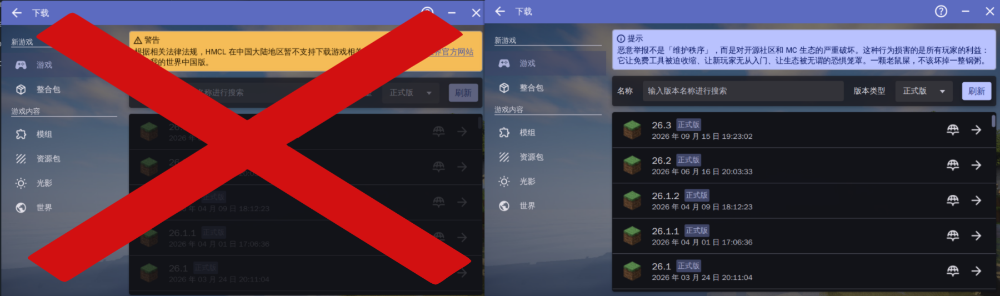

<p align="center">
  
</p>

<h1 align="center">FUCK_HMCL_Pather</h1>

<p align="center">
  <strong>让 HMCL 的下载页重新可用</strong><br>
  移除中国大陆地区下载限制提示 · 替换为社区声明 · 支持 jar / exe / sh / deb
</p>

<p align="center">
  
  
  
  
</p>

---
**中文** (**简体**, [焱暒妏](README_mars.MD))

**重要通知：[上游HMCL正在考虑最终解决方案](https://github.com/HMCL-dev/HMCL/pull/7038)，并暂时移除之前加入的紧急情况临时措施，本项目暂时停止更新，若HMCL后续重新限制中国大陆用户下载Minecraft，<u>本项目将长期维护至HMCL停更或永久移除这种不合理的限制为止！</u>**

## 这是什么

`FUCK_HMCL_Pather` 是一个针对 **HMCL 3.17.dev-583e004**及之后版本限制MC下载的第三方补丁工具。

HMCL 在中国大陆地区会在下载页显示黄色警告，并禁用游戏下载功能。本工具会在**不修改源文件**的前提下，生成一份新的、可以正常使用下载页的 HMCL：

- 把黄色警告改为普通信息提示；
- 把提示文字替换为社区声明；
- 移除地区检测分支中的 `setDisable(true)` 调用，让下载页保持可用；
- 同时支持 HMCL 的 `.jar`、`.exe`、`.sh` 和 `.deb` 发布形式。

> 近期，由于个别人士的恶意举报行为，部分启动器相继关停了下游下载入口。我们对此表示强烈谴责与坚决反对。

> 恶意举报不是「维护秩序」，而是对开源社区和 MC 生态的严重破坏。这种行为损害的是所有玩家的利益：它让免费工具被迫收缩、让新玩家无从入门、让生态被无谓的恐惧笼罩。一颗老鼠屎，不该坏掉一整锅粥。

> **本项目不是 HMCL 官方项目，与 HMCL 开发团队无关。**

## 效果预览

上图为补丁前后的界面对比：原本的黄色警告变成信息提示，下载功能不再被禁用。

## 获取补丁程序

| 文件 | 适用平台 | 运行环境 |
| --- | --- | --- |
| [`FUCK_HMCL_Pather.exe`](./FUCK_HMCL_Pather.exe) | Windows x64 | 无需 Java |
| [`FUCK_HMCL_Pather.sh`](./FUCK_HMCL_Pather.sh) | Linux / macOS | Java 17+ |
| [`FUCK_HMCL_Pather.jar`](./FUCK_HMCL_Pather.jar) | Windows / Linux / macOS | Java 17+ |

> 建议从 GitHub Releases 下载对应文件；如果直接使用仓库根目录中的构建产物，请确认文件完整。

## 功能特性

| 功能 | 说明 |
| --- | --- |
| 解除下载页禁用 | 移除 `VersionsPage` 和模组下载页中的 `setDisable(true)` 调用 |
| 替换警告样式 | 将 `MessageDialogPane.MessageType.WARNING` 改为 `INFO` |
| 替换提示文案 | 将 `download.china` 替换为上方社区声明 |
| 支持 `.jar` | 直接处理普通 HMCL jar |
| 支持 `.exe` | 保留 PE 启动器，只重建尾部内嵌的 jar |
| 支持 `.sh` | 保留自解压脚本头部，只重建尾部内嵌的 jar |
| 支持 `.deb` | 保留 ar 容器，只重建 `data.tar.gz` 中内嵌的 HMCL `.sh` |
| 不修改源文件 | 自动生成 `*-pathed.jar` / `.exe` / `.sh` / `.deb` |
| 自动发现文件 | 不传参数时，自动寻找同目录下最新的 HMCL jar/exe/sh/deb |
| 幂等 | 已经生成过的补丁产物会跳过，不重复处理 |
| 安全校验 | 打补丁前检查目标类和文本，不兼容时直接报错，不写出半成品 |
| 临时文件写入 | 先写临时文件，成功后再替换输出文件 |
| 删除产物 | `--restore` 可以删除生成的 `*-pathed.*` 文件 |
| 无需联网 | 所有操作都在本地完成 |
| Windows 免 Java | `FUCK_HMCL_Pather.exe` 是原生程序，不依赖 Java |

## 快速开始

### 系统要求

- HMCL `3.17.dev-583e004`
- Windows 10/11 x64，或安装了 Java 17+ 的 Linux / macOS
- 关闭正在运行的 HMCL

### 准备工作

1. 关闭正在运行的 HMCL。
2. 确认 HMCL 版本为 **3.17.dev-583e004**（其他版本可能不兼容，见下文）。
3. 把对应的补丁程序放到 HMCL 文件旁边，或者记住 HMCL 的完整路径。

补丁**不会覆盖原文件**，所以不需要提前备份。生成的补丁文件会带 `-pathed` 后缀。

### Windows

使用原生补丁程序，不需要安装 Java：

```bat
FUCK_HMCL_Pather.exe "D:\Games\HMCL-3.17.dev-583e004.exe"
```

也可以直接处理 jar：

```bat
FUCK_HMCL_Pather.exe "D:\Games\HMCL-3.17.dev-583e004.jar"
```

把 `FUCK_HMCL_Pather.exe` 放到 HMCL 文件旁边后，直接双击也可以。程序会自动寻找同目录下最新的一份 `HMCL*.jar`、`HMCL*.exe`、`HMCL*.sh` 和 `HMCL*.deb`。

原生补丁同样接受显式传入 `.sh` / `.deb`，因此在 Windows 上也可以处理下载好的 Linux 发布包。

### Linux / macOS

```sh
chmod +x FUCK_HMCL_Pather.sh
./FUCK_HMCL_Pather.sh /path/to/HMCL-3.17.dev-583e004.jar
```

处理 exe / Linux 自解压脚本 / Debian 包：

```sh
./FUCK_HMCL_Pather.sh /path/to/HMCL-3.17.dev-583e004.exe
./FUCK_HMCL_Pather.sh /path/to/HMCL-3.17.dev-583e004.sh
./FUCK_HMCL_Pather.sh /path/to/HMCL-3.17.dev-583e004.deb
```

把脚本放在 HMCL 文件旁边，直接运行即可自动发现文件：

```sh
./FUCK_HMCL_Pather.sh
```

> `.sh` 和 `.jar` 需要 Java 17 或更高版本；Windows 原生 `.exe` 不需要 Java。

### 使用 Java 补丁程序

任何安装了 Java 17+ 的系统都可以直接运行：

```sh
java -jar FUCK_HMCL_Pather.jar /path/to/HMCL.jar
java -jar FUCK_HMCL_Pather.jar /path/to/HMCL.exe
java -jar FUCK_HMCL_Pather.jar /path/to/HMCL.sh
java -jar FUCK_HMCL_Pather.jar /path/to/HMCL.deb
```

不指定文件时：

```sh
java -jar FUCK_HMCL_Pather.jar
```

### 输出文件命名

补丁会在原文件名的扩展名前追加 `-pathed`：

```text
HMCL-3.17.dev-583e004.jar  ->  HMCL-3.17.dev-583e004-pathed.jar
HMCL-3.17.dev-583e004.exe  ->  HMCL-3.17.dev-583e004-pathed.exe
HMCL-3.17.dev-583e004.sh   ->  HMCL-3.17.dev-583e004-pathed.sh
HMCL-3.17.dev-583e004.deb  ->  HMCL-3.17.dev-583e004-pathed.deb
```

补丁完成后，**运行带 `-pathed` 后缀的文件**，原文件可以继续保留。

## 删除补丁产物

如果不需要补丁后的文件，可以删除它们：

```sh
./FUCK_HMCL_Pather.sh --restore /path/to/HMCL-3.17.dev-583e004.exe
```

```bat
FUCK_HMCL_Pather.exe --restore "D:\Games\HMCL-3.17.dev-583e004.exe"
```

`--restore` 会删除对应的 `*-pathed.jar` / `*-pathed.exe` / `*-pathed.sh` / `*-pathed.deb`。源文件从未被修改，因此不需要从备份还原。

为了兼容早期“原地修改”版本，如果目录中存在 `.fuck_hmcl_pather.bak`，`--restore` 也会顺带把源文件还原。

不指定文件时，会处理自动找到的所有 HMCL jar/exe/sh/deb：

```sh
./FUCK_HMCL_Pather.sh --restore
```

## 补丁原理

### 1. 替换界面类

补丁会更新两个已编译的界面类：

```text
org/jackhuang/hmcl/ui/download/VersionsPage$VersionsPageSkin.class
org/jackhuang/hmcl/ui/instances/DownloadListPage$ModDownloadListPageSkin.class
```

具体改动：

- `MessageDialogPane.MessageType.WARNING` → `MessageDialogPane.MessageType.INFO`
- 删除 `root.setDisable(true)`
- 删除 `pane.setDisable(true)`

这样警告会以信息样式显示，同时下载页面不会被禁用。

### 2. 替换提示文案

遍历 jar 中的 `assets/lang/I18N*.properties`，把 `download.china=` 后面的内容替换为社区声明。

### 3. 写入识别标记

在输出文件中写入：

```text
META-INF/FUCK_HMCL_PATHER.txt
```

用于判断文件是否已经打过补丁，避免重复处理。

### 4. 处理 HMCL exe / sh

HMCL 的 Windows 可执行文件和 Linux / macOS 自解压脚本都由两部分组成：

```text
[PE 启动器或 shell 脚本头][尾部内嵌 jar]
```

补丁会解析 zip 的结束记录，计算出前置数据长度（Windows exe 当前版本为 454144 字节，Linux `.sh` 当前版本为 6125 字节），原样保留启动器或脚本头，只重建尾部内嵌的 jar。因此补丁后的文件仍然由原来的启动器或脚本启动。

### 5. 处理 HMCL deb

HMCL 的 `.deb` 是标准的 Debian ar 容器：

```text
[debian-binary][control.tar.gz][data.tar.gz]
```

补丁原样保留其他 ar 成员，只解压、重建 `data.tar.gz`，并在内层 tar 中找到 `usr/share/java/hmcl/HMCL-*.sh`，对其中尾部内嵌的 jar 执行与上面相同的替换。内层 tar 中文件的权限、时间戳和目录结构保持不变。

### 6. 安全写入

- 先检查目标类、`download.china` 文本是否存在；
- 任何一项缺失都会直接报错退出；
- 补丁结果先写到临时文件；
- 成功后才替换输出文件，避免留下半成品。

## 兼容性

### 已验证版本

- HMCL `3.17.dev-583e004`
- HMCL `3.17.0.362`
- class 文件版本：Java 17（classfile version 61）
- Windows exe 启动器长度：454144 字节
- Linux `.sh` 脚本头长度：6125 字节（补丁会动态计算，不依赖固定值）
- Debian 包：`data.tar.gz` 内嵌 HMCL `.sh` 的格式

### 其他版本

当前替换类是按 `3.17.dev-583e004` 编译的，经测试已支持 `3.17.0.362` 。如果 HMCL 后续版本修改了下载页面结构，补丁会先检测，然后安全地报错，不会写出损坏的文件。

`.sh` 和 `.deb` 的定位不依赖固定版本号：补丁会动态计算内嵌 jar 的偏移，并在 deb 中按文件名查找 HMCL 脚本。如果后续 Debian 包改用 `data.tar.xz` 等其他压缩格式，补丁会明确提示暂不支持，而不会生成损坏的包。

如果 HMCL 更新后需要适配，可以使用 `FUCK_HMCL_Pather/patches/hmcl-download-china.patch` 作为源码参考，并重新生成 `go/payload/` 中的替换类。

### 关于完整性校验

补丁会重新打包 HMCL 文件，因此 HMCL 可能提示签名缺失或完整性校验失败。这与直接使用未签名的 dev 构建时可能出现的情况类似，通常不影响启动。

如果遇到启动问题，请先确认：

1. 运行的是 `*-pathed.*` 文件；
2. HMCL 版本与补丁版本匹配；
3. Java 版本不低于 17；
4. 原文件没有被其他工具修改。

## 项目结构

```text
.
├── image.png                         # README 头图 / 效果对比
├── README.MD                         # 本文件
├── FUCK_HMCL_Pather.sh               # Linux / macOS 自包含补丁
├── FUCK_HMCL_Pather.exe              # Windows x64 原生补丁
├── FUCK_HMCL_Pather.jar              # Java 补丁程序
└── FUCK_HMCL_Pather/
    ├── src/                          # Java 补丁程序源码
    ├── go/                           # Windows 原生补丁源码与替换类
    ├── patches/                      # HMCL 源码补丁
    ├── tools/                        # 替换类生成脚本
    ├── dist/                         # 构建产物
    ├── build.sh                      # 一键构建
    ├── README.md                     # 项目开发说明
    └── LICENSE                       # GPLv3
```

## 从源码构建

### 环境要求

- JDK 17+
- Go 1.23+
- 标准 `jar`、`base64` 工具

### 构建

```sh
cd FUCK_HMCL_Pather
./build.sh
```

构建产物：

```text
FUCK_HMCL_Pather/dist/FUCK_HMCL_Pather.jar
FUCK_HMCL_Pather/dist/FUCK_HMCL_Pather.sh
FUCK_HMCL_Pather/dist/FUCK_HMCL_Pather.exe
```

如果 Go 不在 `PATH` 中，可以指定路径：

```sh
GO=/path/to/go ./build.sh
```

如果本机没有 Go，构建仍会生成 jar 和自包含 `.sh`，只跳过 Windows 原生 `.exe`。

### 更新 HMCL 版本后重新生成替换类

`go/payload/` 中已经包含当前版本编译好的替换类。只要 HMCL 版本不变，重新执行 `build.sh` 不需要 JavaFX。

如果更换了 HMCL 版本，需要从 HMCL 源码重新生成替换类（需要 Python 3 和 JavaFX）：

```sh
cd FUCK_HMCL_Pather
./tools/build-payload.sh [HMCL.jar] [HMCL-main] [JavaFX目录]
```

## 常见问题

### 双击没有反应？

Windows 原生补丁会在控制台输出结果。如果双击后窗口一闪而过，可以打开 `cmd` 或 PowerShell，执行：

```bat
FUCK_HMCL_Pather.exe "HMCL-3.17.dev-583e004.exe"
```

这样可以看到完整的错误信息。

### 提示“没有找到 HMCL 文件”？

把补丁程序放到 HMCL 文件旁边，或者显式传入文件路径。自动发现只处理 `HMCL*.jar`、`HMCL*.exe`、`HMCL*.sh`、`HMCL*.deb`。

### 提示文件已打过补丁？

说明对应的 `*-pathed.*` 文件已经存在。直接运行该文件即可；如果需要重新生成，先删除旧产物，或使用 `--restore`。

### 补丁后 HMCL 能否进行正版登录？

经测试正版登录功能是可以正常登录进入游戏的。请确认运行的是 `*-pathed.*` 文件，并保留原始文件以便对照。

### 需要 Java 吗？

- `FUCK_HMCL_Pather.exe`：不需要。
- `FUCK_HMCL_Pather.sh`：需要 Java 17+。
- `FUCK_HMCL_Pather.jar`：需要 Java 17+。

### 会修改原文件吗？

不会。补丁只读取源文件，并把结果写到新的 `*-pathed.*` 文件。符合HMCL的附加条款。

### 会绕过账号、网络或版权限制吗？

不会。本工具只修改 HMCL 界面层的下载提示和禁用状态，不绕过任何网络、账号或版权限制。

## 免责声明

- 本项目是第三方补丁，不是 HMCL 官方项目。补丁按现状提供，不保证兼容性或可用性
- HMCL 是 [HMCL-dev/HMCL](https://github.com/HMCL-dev/HMCL) 的开源项目；请勿将本工具相关的问题反馈给 HMCL 官方。
- 本工具只解除 HMCL 界面层面对下载功能的禁用，不绕过任何网络、账号或版权限制。
- 请支持正版游戏，并遵守所在地法律法规。
- 使用本工具产生的风险由使用者自行承担。


## 相关项目

- [PCL-Re.Download_PATCH](https://github.com/Jelly10086/PCL-Re.Download_PATCH/tree/main)
（与本项目的原理区别：本项目更改的是UI类的二进制补丁JAVA的class类，这个项目改的是静态 IL/字节码补丁使用 Mono.Cecil 分析并修改 .NET 程序集（PCL）或相关逻辑。支持多种启动器但依赖Windows系统，不支持其它系统。）

- [UnblockMCDownload](https://github.com/TianMengLucky/UnblockMCDownload) （与本项目的原理区别：该项目由Rust+GPUI实现，思路和PCL-Re.Download_PATCH高度相似，依赖Windows系统且仅支持exe，但拥有GUI页面和工具自动更新等功能）

- [HKRegionHook](https://github.com/CubeSkyForked/pcl-hmcl-country-bypass)
（与本项目的原理区别：通过运行时注入 + API Hook + 动态分析骗启动器“你现在在香港”，并且在运行时动态改判定逻辑。）
## 许可证

本项目以 **GPLv3** 发布。`go/payload/` 中的替换类派生自 HMCL，同样遵循 GPLv3。

完整许可证见 [`FUCK_HMCL_Pather/LICENSE`](FUCK_HMCL_Pather/LICENSE)。

---

<p align="center">
  <sub>Made for the Minecraft community. 反对恶意举报，支持开源生态。</sub>
    <sub>Made BY deepseekV4.1 Flash AND xiaohuangbo</sub>
</p>
